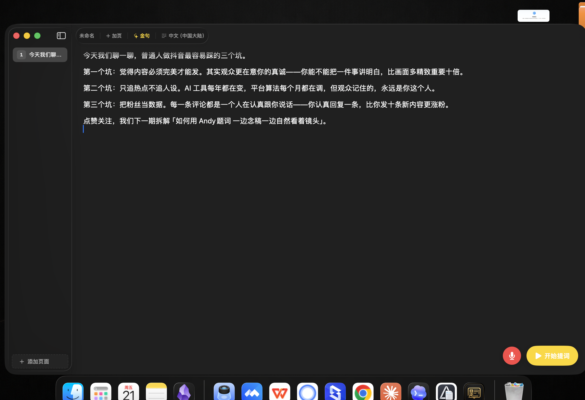
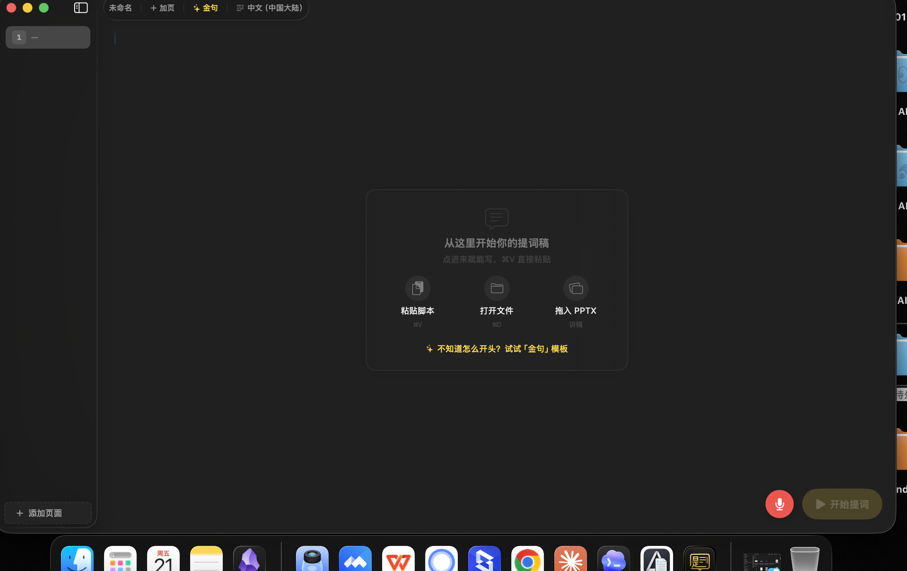
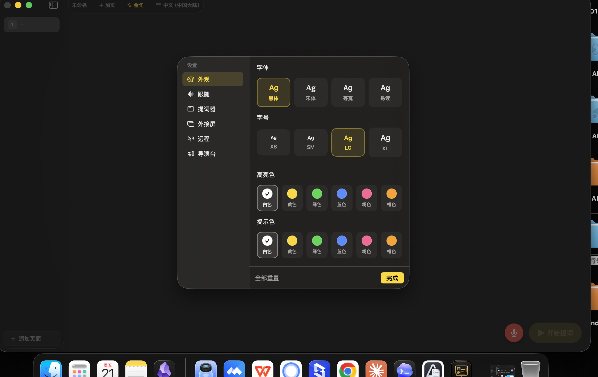

<p align="center">
  
</p>


<h1 align="center">Andy题词</h1>

<p align="center">
  <strong>The teleprompter that listens.</strong><br>
  A native macOS workspace for Chinese-speaking video creators — write the script in the editor, speak in front of the camera, and the highlight follows the words you actually said.
</p>

<p align="center">
  <a href="https://github.com/AIPMAndy/andytici/releases/latest"><strong>Download</strong></a>
  &nbsp;·&nbsp;
  <a href="README.zh-CN.md">中文说明</a>
  &nbsp;·&nbsp;
  <a href="https://github.com/AIPMAndy/andytici/issues">Feedback</a>
</p>

<p align="center">
  <a href="https://github.com/AIPMAndy/andytici/releases"></a>
  
  
</p>

<br>

<p align="center">
  
</p>

<p align="center"><sub>Write the script in one window, speak in front of the camera in another. The app is the bridge between them.</sub></p>

---

## Why a teleprompter that listens

Most prompters scroll on a clock. Say a sentence faster than the timer expected, and the highlight is already three lines ahead. Pause to think, and the script runs away from your eyes. You end up reading the screen instead of looking at the camera.

Andy题词 does not scroll on a timer. It runs Chinese speech recognition on the script you wrote, listens to your voice through the Mac microphone, and moves the highlight to whatever you actually said. When you improvise, pause, restart, or skip ahead, the script waits for you. Your eyes stay near the lens, your delivery stays natural.

## What it looks like in real use

The three screenshots below are real captures from a running build — no mockups.

**The editor with a script loaded.** The page sidebar on the left holds the script pages, the editor fills the middle, the controls stay at the bottom. A short 口播稿 sits in the editor with emoji cues and gold highlight markers on the phrases you marked for emphasis.


**The empty state when you first open it.** Paste from the clipboard with ⌘V, open a file with ⌘O, or drop a `.pptx` onto the window. The gold hint at the bottom suggests the Hook template if you do not know how to start.



**Settings — the part that decides whether the highlight feels right.** Six tabs. The 外观 tab below controls font family, font size, the color used for the highlighted word, and the color used for the upcoming hint. Six swatches each, picked to survive both light and dark backgrounds.



---

## Designed for Chinese-speaking creators

Andy题词 is built around how Chinese 口播 actually works — short hooks, emoji cues, repeated calls-to-action, and a script that is meant to be read aloud rather than silently skimmed.

- **Chinese-first speech recognition.** Recognition uses the system locale and feeds a small creator vocabulary (`KouboVocabulary.swift`) — 点赞、关注、扣1、上链接 — so common phrases match the script instead of getting misheard.
- **Hook templates and cue markers.** The toolbar inserts a Hook template, a call-to-action block, an emoji bullet, and three standard 金句 phrasing patterns. Script tags (`ScriptTag.swift`) colorize emphasis, pauses, and key lines in the running overlay.
- **Page-aware scripts.** Long scripts split into pages. The sidebar lets you reorder, rename, and jump. Pages are saved as a portable `.andytici` bundle so you can move work between machines.
- **Reading layouts that survive the camera.** Main window editor, floating overlay (`FloatingOverlayView`), MacBook notch overlay (`NotchOverlayController`), and a full external display renderer (`ExternalDisplayController`). Pick the layout that puts the script closest to the lens.
- **Local network browser and director modes.** Start `BrowserServer` and another device on the same Wi-Fi sees the script in a phone-sized view. Start `DirectorServer` and the phone can pause, jump, or switch pages.
- **macOS Services and URL scheme.** Select text anywhere — Shortcuts, Raycast, Alfred, or another app — and send it through the Services menu or the `andytici://read?text=...` URL. Multi-line scripts need the part after `text=` URL-encoded.

### The URL scheme in practice

```text
andytici://read?text=%E4%BB%8A%E5%A4%A9%E6%88%91%E4%BB%AC%E8%81%8A%E4%B8%80%E8%81%8A%E5%BC%80%E5%A4%A7%E5%B8%88%E7%9A%84%E6%96%B0%E4%B9%A6
```

The handler lives in `TextreamService.swift`. It opens Andy题词, loads the encoded text into a new page, and brings up the running overlay.

---

## Install

Grab the disk image from [GitHub Releases](https://github.com/AIPMAndy/andytici/releases/latest), open it, and drag **Andy题词.app** into `/Applications`.

The release is ad-hoc signed. The first time macOS Gatekeeper sees the binary it will ask:

1. In Finder, right-click **Andy题词.app** and choose **Open**.
2. Confirm **Open** once more.
3. When you switch on voice-following, grant Microphone and Speech Recognition access.

The approval only happens once. After that the app launches normally.

## Build from source

You do not need a full Xcode install. The shipped script uses Xcode Command Line Tools only.

```bash
git clone https://github.com/AIPMAndy/andytici.git
cd andytici/Textream

# Apple Silicon local build — fastest, what daily development uses
./build_no_xcode.sh
open build/release/Andy题词.app

# Universal build — fat binary for distribution
./build_no_xcode.sh --universal
```

What you need on the machine:

- macOS 15 or later
- Xcode Command Line Tools (`xcode-select --install`)
- Xcode 16+ only if you prefer opening `Textream.xcodeproj` instead of the script

The script compiles the Swift sources, assembles the `.app` bundle, regenerates the icon, and applies an ad-hoc signature. The release recipe lives in [RELEASE.md](RELEASE.md).

<details>
<summary><strong>Project map</strong></summary>

```text
andytici/
├── README.md
├── README.zh-CN.md
├── RELEASE.md
├── Casks/andytici.rb
├── docs/screenshots/
└── Textream/
    ├── Textream/
    │   ├── ContentView.swift              # main editor + sidebars
    │   ├── WelcomeView.swift              # 3-step first-run intro
    │   ├── SettingsView.swift             # 6-tab preferences
    │   ├── SpeechRecognizer.swift         # voice-following engine
    │   ├── SpeechTextAlignment.swift      # spoken words → script position
    │   ├── NotchOverlayController.swift   # MacBook notch overlay
    │   ├── ExternalDisplayController.swift
    │   ├── BrowserServer.swift            # local-network read view
    │   ├── DirectorServer.swift           # local-network remote control
    │   ├── TextreamService.swift          # URL scheme handler
    │   ├── HookTemplate.swift             # opening structure inserts
    │   ├── ScriptTag.swift                # inline cue markers
    │   ├── KouboVocabulary.swift          # creator recognition hints
    │   └── PlatformPreset.swift           # 抖音 / 小红书 / 视频号 presets
    ├── TextreamTests/
    ├── Textream.xcodeproj/
    └── build_no_xcode.sh
```

</details>

---

## What's actually verified

This section is honest about what has been tested on real hardware versus what compiles but is not exercised. If something is not on the list, treat it as unverified.

| Area | Status |
| --- | --- |
| Apple Silicon (arm64) | Built and used daily on real hardware |
| Intel (x86_64) | Universal binary compiles; not yet run on an Intel Mac |
| Code signing | Ad-hoc signed; Apple notarization is not enabled |
| External display mode | Implemented; only tested on a single physical second monitor |
| Automated tests | XCTest sources exist (`TextreamTests/`); no CI runner is configured |
| Voice-following accuracy | Works on real scripts in quiet rooms; noisy environments are not yet characterized |

These limits are documented openly so users can decide whether the current release covers their setup.

## Contributing

Issues and focused pull requests are welcome. For larger changes — new layouts, new modes, new recognition backends — open an issue first so the scope can be agreed before any code is written.

Please keep with the existing SwiftUI structure, keep user-facing copy Chinese-first, and avoid adding cloud dependencies to the core reading flow. The whole point of Andy题词 is that the script and the recognition stay on the machine.

<!-- andy-author-card:start -->
## 作者 / About the author

**AI 酋长 Andy（Andy Liu，GitHub/X @AIPMAndy）**：前腾讯/百度 AI 产品专家，大模型独角兽前 VP，现专注 AI + 产品方法论创业。

微信 `AIPMAndy`（备注「andytici」） · [X @AIPMAndy](https://x.com/AIPMAndy) · [Telegram @AIPMAndy](https://t.me/AIPMAndy) · [个人官网 metaver.vip](https://metaver.vip/)

*AI Chief Andy (Andy Liu, @AIPMAndy on GitHub and X) is a former Tencent and Baidu AI product expert and former VP at an LLM unicorn, now a serial entrepreneur focused on AI and product methodology.*

### 作者的其他项目

- [AndySoul](https://github.com/AIPMAndy/AndySoul)：CLAUDE.md / AGENTS.md 规则模板，让 Claude Code、Codex、Cursor 少犯错
- [DNA Memory](https://github.com/AIPMAndy/dna-memory)：Claude Code、Codex 共用的本地 AI Agent 记忆 MCP
- [SafeSkill](https://github.com/AIPMAndy/safeskill)：装 AI Skill 之前，先扫危险命令、提示注入和密钥泄露
- [OpenClaw Skills 中文精选](https://github.com/AIPMAndy/awesome-openclaw-skills-CN)：OpenClaw Skills 分类整理，附国产模型接入指南
- [Grok Bot 中文攻略](https://aipmandy.github.io/grok-bot-handbook/)：AI Agent 中文教程

<!-- andy-author-card:end -->

## License

Andy题词 is available under the [MIT License](LICENSE).

<p align="center">
  <sub>把眼睛留给镜头，把滚动交给 Andy题词。</sub>
</p>
